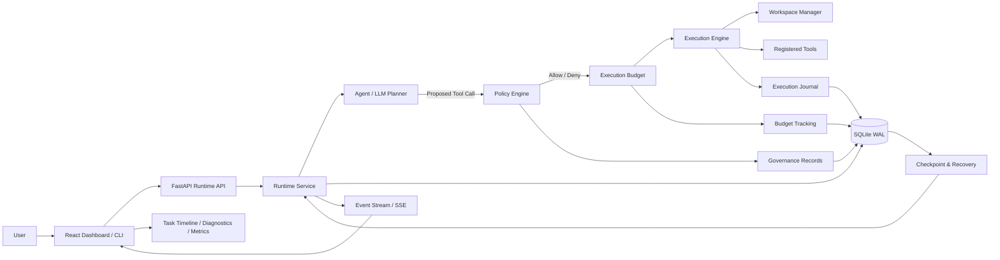
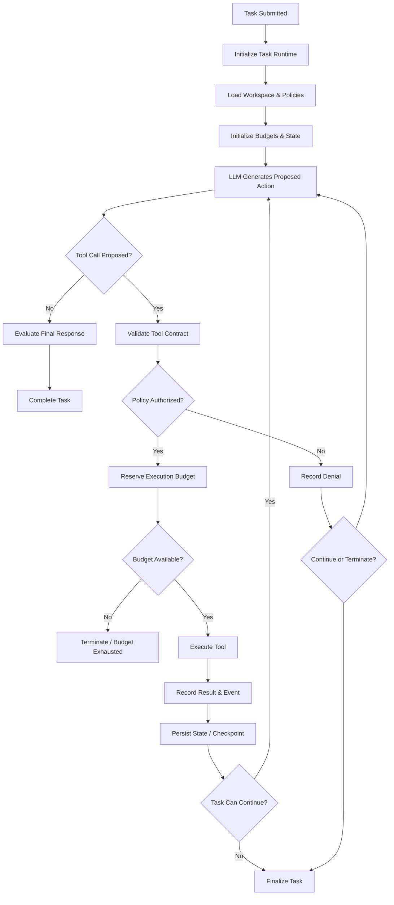
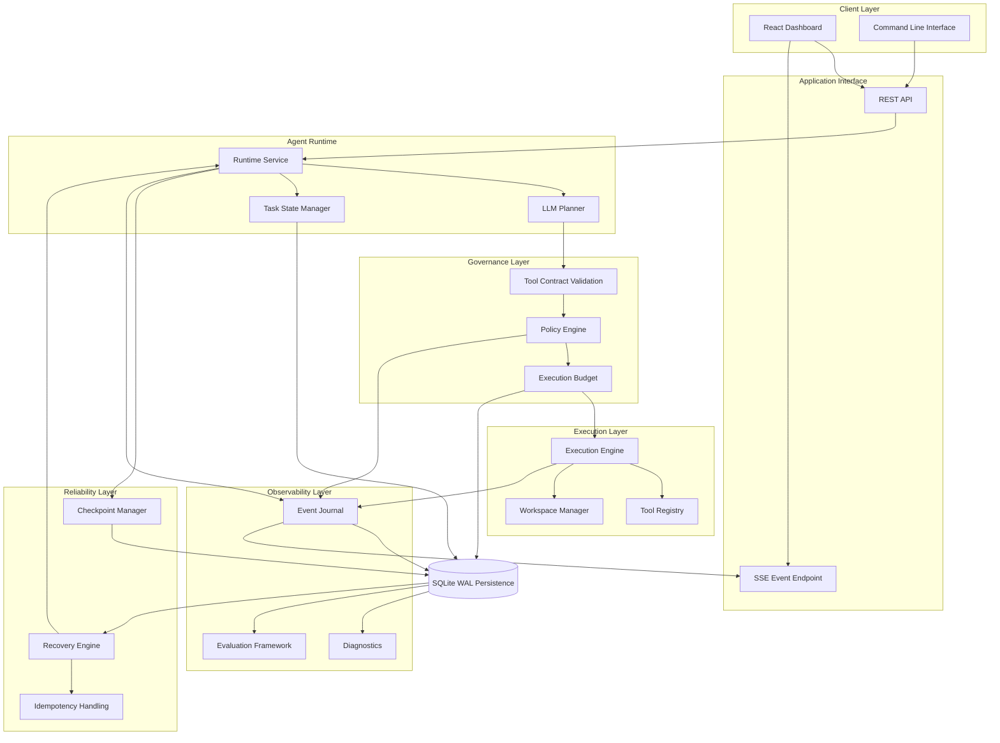
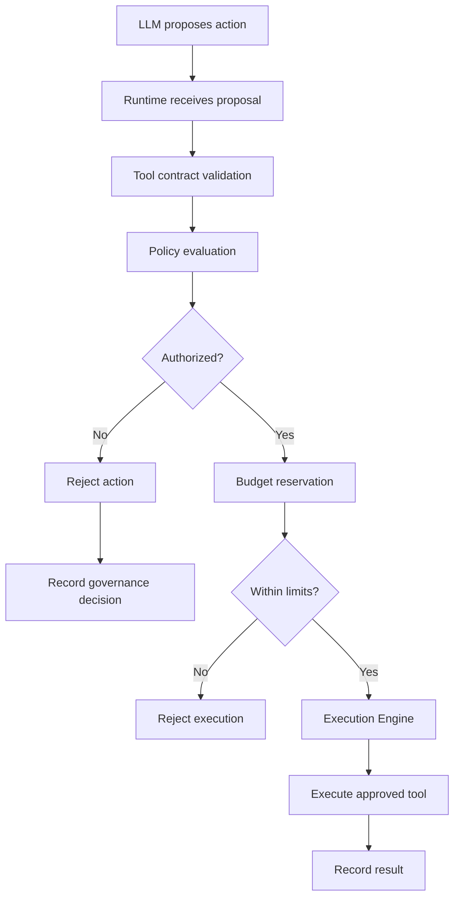
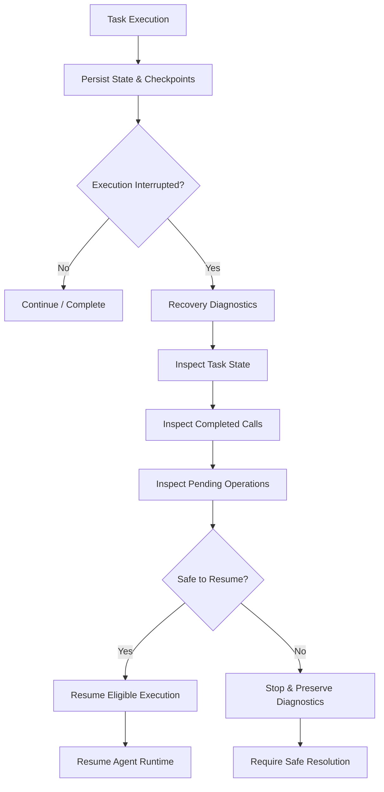
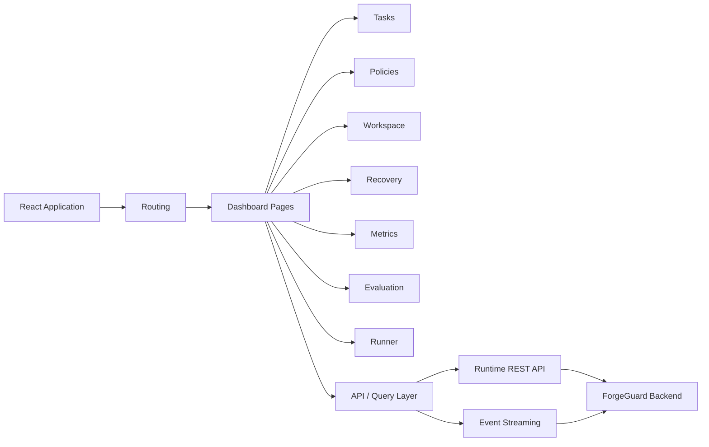

<p align="center">
  
</p>

<h1 align="center">🛡️ ForgeGuard</h1>

<p align="center">
  <strong>Reliable AI Agent Execution Runtime</strong><br/>
  <em>Control. Recover. Observe. Evaluate.</em>
</p>

<p align="center">
  <a href="https://www.python.org/">
    
  </a>
  <a href="https://fastapi.tiangolo.com/">
    
  </a>
  <a href="https://react.dev/">
    
  </a>
  <a href="https://www.typescriptlang.org/">
    
  </a>
  <a href="https://vite.dev/">
    
  </a>
  <a href="https://mui.com/">
    
  </a>
  <a href="https://www.sqlite.org/">
    
  </a>
  <a href="https://developer.mozilla.org/en-US/docs/Web/API/Server-sent_events">
    
  </a>
</p>

<p align="center">
  
  
  
  
  
</p>

---

ForgeGuard is a governed AI agent execution runtime designed to make agent-driven workflows more controlled, observable, recoverable, and predictable.

Instead of allowing an LLM to directly execute arbitrary tools, ForgeGuard separates reasoning from authorization and execution. The LLM proposes actions, while the runtime independently validates those actions against policies, execution budgets, workspace restrictions, and operational constraints.

It combines a policy-governed execution engine, durable task state, recovery mechanisms, event-based observability, deterministic evaluations, APIs, a CLI, and a monitoring dashboard into a unified system.

> **Core Invariant:**  
> **LLMs propose actions. ForgeGuard decides whether those actions can execute.**

---

## Architecture at a Glance



---

## Why ForgeGuard?

AI agents can dynamically decide what to do next, but unrestricted tool execution introduces risks such as:

- Unauthorized tool usage
- Uncontrolled execution loops
- Excessive resource consumption
- Unsafe workspace access
- Unreliable execution after failures
- Duplicate execution of operations
- Limited visibility into agent decisions
- Difficult debugging of agent workflows

ForgeGuard addresses these concerns by placing a deterministic runtime between the agent's decisions and the actual execution of tools.

| Challenge | ForgeGuard Approach |
|---|---|
| **Unrestricted tool invocation** | Default-deny policy enforcement |
| **Invalid tool arguments** | Typed tool contracts and validation |
| **Excessive agent execution** | Runtime-enforced execution budgets |
| **Workspace traversal** | Strict workspace boundary validation |
| **Failed or interrupted tasks** | Checkpointing and recovery mechanisms |
| **Duplicate execution risk** | Idempotency-aware execution and recovery |
| **Poor execution visibility** | Event journal and execution timeline |
| **Difficult agent evaluation** | Deterministic evaluation suites |

---

## Core Capabilities

### 1. Policy-Governed Tool Execution
Every proposed tool call passes through the runtime's authorization layer before execution.
- Default-deny authorization model
- Explicit tool allow/deny policies
- Typed tool contracts and argument validation
- Policy decision records
- Denied execution attempts are recorded
- Tool execution is separated from LLM decision-making

*The LLM does not receive unrestricted execution authority.*

### 2. Execution Budgets
ForgeGuard enforces runtime limits to prevent uncontrolled agent behavior.

| Budget | Default Limit | Description |
|---|---|---|
| **Tool calls** | `20` | Maximum tool invocations per task |
| **Total task duration** | `120.0s` | Maximum total elapsed execution duration |
| **Consecutive failures** | `5` | Maximum consecutive tool failures before halting |
| **Tool output size** | `1 MB` | Cumulative output byte cap for stored results |
| **Per-tool execution time** | `30.0s` | Individual tool invocation timeout |

*Budgets are enforced by the runtime rather than relying on the LLM to follow instructions.*

### 3. Durable Execution & Recovery
Tasks maintain durable state to support execution tracking and recovery.
- Persistent task state
- Execution checkpoints
- Recovery diagnostics
- Completed-call history
- Task interruption detection
- Resume handling
- Idempotency-aware re-execution
- Safeguards against uncertain side-effecting operations

*Recovery behavior is designed to avoid blindly repeating operations when the runtime cannot determine whether an operation has already taken effect.*

### 4. Workspace Isolation
Workspace operations are restricted by a dedicated workspace manager.
- Strict path containment
- Path traversal rejection (`../`, `..\`)
- Absolute-path restrictions
- Symlink escape protection
- Sensitive file pattern restrictions (`.env`, `.git`, `id_rsa`)
- Workspace-aware tool execution

*The workspace manager serves as a boundary between agent-requested file operations and the underlying filesystem.*

### 5. Execution Observability
ForgeGuard maintains execution records and diagnostic information for investigating task behavior.
- Task event journal
- Tool invocation records
- Policy decision history
- Budget utilization
- Checkpoints
- Recovery diagnostics
- Task lifecycle events
- Real-time event streaming (SSE)
- Execution timeline

### 6. Deterministic Evaluation
ForgeGuard includes evaluation infrastructure for validating runtime behavior and system-level expectations.
- Deterministic test scenarios
- Runtime behavior verification
- Governance validation
- Recovery-related regression testing
- Structured evaluation results (JSON & Markdown)

*The evaluation layer focuses on runtime reliability and enforcement rather than assuming an LLM response is correct.*

---

## Execution Lifecycle

A task follows a controlled execution lifecycle:



### Execution Sequence
1. A task is submitted through the API, CLI, or dashboard.
2. The runtime initializes task state, workspace context, policies, and execution budgets.
3. The agent produces a response or structured tool-call proposal.
4. Proposed tool calls are validated against their registered contracts.
5. The policy engine evaluates whether the operation is authorized.
6. Execution budgets are checked and reserved.
7. Authorized operations are executed by the execution engine.
8. Results, policy decisions, budget usage, and execution events are recorded.
9. Task state and checkpoints are persisted.
10. The runtime either continues the agent loop, completes the task, or stops safely.

---

## System Architecture

ForgeGuard is organized around separation of responsibilities. The runtime orchestrates tasks, governance determines authorization, the execution engine handles approved operations, and persistence supports diagnostics and recovery.

### Architectural Components

| Component | Responsibility |
|---|---|
| **Runtime Service** | Task orchestration, agent interaction, lifecycle management |
| **Agent / LLM Planner** | Proposes next actions and tool calls |
| **Tool Registry** | Defines supported tools and their contracts |
| **Policy Engine** | Evaluates whether proposed actions are authorized |
| **Execution Budget** | Enforces resource and execution limits |
| **Execution Engine** | Runs approved tool calls |
| **Workspace Manager** | Enforces workspace boundaries |
| **Persistence Layer** | Stores task state, events, checkpoints, and diagnostics |
| **Recovery Engine** | Analyzes interrupted execution and recovery eligibility |
| **Event System** | Publishes lifecycle and execution events |
| **API Layer** | Exposes runtime functionality to clients |
| **CLI** | Enables terminal-based interaction |
| **Dashboard** | Provides execution visibility and management |
| **Evaluation Framework** | Validates runtime behavior through deterministic tests |

### Component Interaction



---

## Governance Model

ForgeGuard follows a strict separation-of-authority model:



The LLM is responsible for proposing what should happen next. It is not responsible for deciding whether an operation is permitted.

The runtime independently enforces:
- Tool authorization
- Input contracts
- Resource limits
- Workspace restrictions
- Execution state
- Recovery constraints

*This architecture eliminates dependence on model-generated instructions as a security or control mechanism.*

---

## Recovery & Reliability

Agent execution can fail because of tool errors, timeouts, process interruptions, or application restarts. ForgeGuard maintains execution state and diagnostic records to support controlled recovery.



### Recovery Safeguards
- Durable execution records
- Read-only diagnostics
- Recovery eligibility checks
- Completed operation history
- Idempotency-aware execution
- Protection against uncertain side-effecting operations
- Persistent recovery information

*Recovery is not equivalent to automatically retrying every failed operation. The runtime considers execution state and operation safety before attempting continuation.*

---

## Observability

ForgeGuard makes task execution inspectable instead of treating an agent run as a black box.

### Execution Events
The event system supports task lifecycle and execution-related event categories, including:
`task_started` • `plan_created` • `plan_updated` • `thinking` • `tool_call` • `tool_result` • `approval_required` • `token_usage` • `error` • `task_completed` • `task_failed` • `task_cancelled` • `sync_gap`

The dashboard consumes task information and events to display execution progress and diagnostic details.

### Event Streaming
The runtime exposes Server-Sent Events (SSE) for task event streaming, with support for:
- Event sequence tracking
- Event replay
- `Last-Event-ID` handling
- Replay buffering
- Keepalive heartbeats
- Reconnection behavior
- Synchronization gap handling

*This enables clients to reconnect and recover event context instead of depending exclusively on a continuously open connection.*

---

## Dashboard

ForgeGuard includes a React-based dashboard for inspecting and interacting with the runtime.

### Dashboard Capabilities
- **Task overview and management**: Paginated task history, search, status filtering, and modal task creation.
- **Task execution detail**: Live execution timeline, tool arguments, outputs, and token metrics.
- **Live execution streaming**: Real-time SSE updates and elapsed duration counters.
- **Workspace explorer**: Sandboxed workspace management, directory tree browsing, and secure read-only preview.
- **Policy inspection**: Default-deny rules, permission matrices, and authorized/denied ledgers.
- **Budget inspection**: Real-time progress bars for tool calls, seconds, failures, and output bytes.
- **Recovery diagnostics**: Reconstructed execution position, checkpoint forensics, and safe resume controls.
- **Runtime metrics**: Aggregate success rates, latency distributions, and tool failure diagnostics.
- **Evaluation center & runner**: Launching and monitoring 20 deterministic scenarios across 5 suites.

### Dashboard Architecture



---

## Technology Stack

### Backend
| Technology | Purpose |
|---|---|
| [Python](https://www.python.org/) | Core runtime and application logic |
| [FastAPI](https://fastapi.tiangolo.com/) | API layer and ASGI application |
| [Pydantic](https://docs.pydantic.dev/) | Structured validation and typed contracts |
| [SQLite](https://www.sqlite.org/) | Durable task and runtime persistence |
| [SQLite WAL](https://www.sqlite.org/wal.html) | Persistence and concurrency mode |
| [Pytest](https://docs.pytest.org/) | Automated backend testing |
| [Ruff](https://docs.astral.sh/ruff/) | Python linting and code formatting |
| [Mypy](https://mypy.readthedocs.io/) | Static type checking |

### Frontend
| Technology | Purpose |
|---|---|
| [React](https://react.dev/) | UI component framework |
| [TypeScript](https://www.typescriptlang.org/) | Type-safe frontend development |
| [Vite](https://vite.dev/) | Development server and build system |
| [Material UI](https://mui.com/) | UI component system |
| [Emotion](https://emotion.sh/docs/introduction) | Styling infrastructure |
| [TanStack Query](https://tanstack.com/query/latest) | Server-state management and caching |
| [Zustand](https://zustand.docs.pmnd.rs/) | Client-state management |
| [React Router](https://reactrouter.com/) | Navigation and routing |
| [Vitest](https://vitest.dev/) | Unit and integration testing |
| [React Testing Library](https://testing-library.com/docs/react-testing-library/intro/) | Component testing |

### Runtime & Communication
| Technology | Purpose |
|---|---|
| [REST](https://developer.mozilla.org/en-US/docs/Web/HTTP/Methods) | API communication |
| [Server-Sent Events](https://developer.mozilla.org/en-US/docs/Web/API/Server-sent_events) | Live task event streaming |
| [SQLite WAL](https://www.sqlite.org/wal.html) | Durable execution persistence |

---

## Testing & Verification

ForgeGuard was validated through backend unit tests, frontend component tests, static type checking, linting, production builds, and runtime smoke checks.

### Reported Verification Results

| Verification | Result |
|---|---|
| **Backend unit tests** | **219 / 219 passed** |
| **Backend test runtime** | **20.87 seconds** |
| **Frontend tests** | **165 / 165 passed** |
| **Frontend test files** | **27 test files** |
| **Frontend test runtime** | **331.11 seconds** |
| **TypeScript typecheck** | **0 errors** (`tsc --noEmit`) |
| **Ruff** | **0 issues reported** |
| **Mypy** | **0 errors reported** |
| **Production frontend build** | **Passed** |
| **Vite modules transformed** | **2,602 modules** |
| **Production build duration** | **22.11 seconds** |
| **Backend health endpoint** | **HTTP 200 OK** |
| **Frontend availability smoke check** | **HTTP 200 OK** |

### Verified Subsystems

<details>
<summary><b>Backend Verification (219 passed)</b></summary>

- Governance and authorization behavior
- Runtime execution behavior
- Tool validation and contract checking
- Task state handling and concurrency
- Workspace boundary enforcement and path traversal defenses
- Persistence behavior in SQLite WAL mode
- Recovery-related behavior and interrupted execution safeguards
- Regression coverage for diagnostics and workspace identity
</details>

<details>
<summary><b>Frontend Verification (165 passed across 27 files)</b></summary>

- TypeScript strict type checking
- Dashboard component, page, and state verification
- Production build verification
- Live execution inspector and SSE streaming replay
- Governance, policy, budget, recovery, and evaluation workflows
</details>

<details>
<summary><b>Static Analysis and Build</b></summary>

- Ruff linting and formatting
- Mypy static type checking
- TypeScript compilation (`tsc --noEmit`)
- Vite production build
- Backend and frontend smoke checks
</details>

### Regression Scenarios Addressed

The final verification cycle specifically investigated and corrected the following dashboard/runtime discrepancies:
1. **Workspace identity mismatch**: Fixed `submit_task` dropping workspace identifier before persistence.
2. **Budget accounting inconsistency**: Fixed `get_task` missing checkpoint snapshot and un-masked fallback state.
3. **Missing policy decisions**: Added timeline fallback to policy extractor and integrated task diagnostics on policy ledgers.
4. **Completed tasks marked interrupted**: Eliminated destructive state mutations during read-only diagnostics requests.
5. **Missing recovery history**: Reconstructed completed calls truthfully from persisted checkpoints and timeline events.

---

## Project Structure

```text
ForgeGuard/
├── src/
│   └── forgeguard/
│       ├── agent/          # Agent models, LLM orchestrator, providers, and tools
│       ├── api/            # FastAPI routes, schemas, auth, error handling, SSE
│       ├── budgets/        # Centralized resource limits and consumption tracking
│       ├── core/           # Core task definitions, enums, and exceptions
│       ├── evaluation/     # Deterministic evaluation suites and runner service
│       ├── events/         # Structured execution events and payload definitions
│       ├── execution/      # Governed execution engine and tool invocation context
│       ├── observability/  # Event journal, tracer, timeline, and diagnostics manager
│       ├── persistence/    # SQLite WAL persistence, repositories, schema, checkpoints
│       ├── policies/       # Default-deny authorization engine and policy rules
│       ├── runtime/        # High-level runtime service coordinating execution
│       ├── sdk/            # Python client SDK for programmatic task submission
│       ├── tools/          # Tool registry, contracts, schema validation, workspace tools
│       ├── workspaces/     # Sandboxed workspace manager with path containment
│       ├── cli.py          # Unified command-line interface
│       └── config.py       # Pydantic environment and runtime configuration
├── tests/
│   └── unit/               # 219 automated unit and regression tests
├── dashboard/
│   ├── src/
│   │   ├── api/            # API client, TanStack Query hooks, SSE streaming client
│   │   ├── components/     # UI design system, inspectors, cards, timeline, modals
│   │   ├── pages/          # Dashboard views (Tasks, Live, Policies, Budgets, Workspaces, Eval)
│   │   ├── stores/         # Zustand client state (UI state, connection monitoring)
│   │   ├── theme/          # Dark-first design tokens and Material UI theme
│   │   └── test/           # 165 Vitest unit and integration test specs
│   ├── index.html
│   ├── package.json
│   └── vite.config.ts
├── eval_reports/           # Generated evaluation reports (JSON & Markdown)
├── pyproject.toml          # Python package specification and tool configurations
└── README.md
```

---

## Getting Started

### Prerequisites
- Python 3.10+
- Node.js 20+
- npm
- Git

### Clone the Repository
```powershell
git clone <YOUR_REPOSITORY_URL>
cd ForgeGuard
```

### Backend Setup
Create and activate a virtual environment:
```powershell
python -m venv .venv
.\.venv\Scripts\Activate.ps1
```

Install the backend in editable mode:
```powershell
pip install -e .
```

Start the backend:
```powershell
forgeguard server --host 127.0.0.1 --port 8000 --dev
```

The API should be available at:
- **API:** `http://127.0.0.1:8000`
- **Swagger Documentation:** `http://127.0.0.1:8000/docs`

### Frontend Setup
Open another terminal:
```powershell
cd dashboard
npm install
npm run dev
```

Open the dashboard using the URL printed by Vite (typically `http://localhost:3000` or `http://localhost:5173`).

---

## Running the Tests

### Backend Unit Tests
```powershell
$env:PYTHONPATH="src"
.\.venv\Scripts\pytest tests\unit
```

### Frontend Tests
```powershell
npm test --prefix dashboard -- --run
```

### Type Checking
```powershell
npm run typecheck --prefix dashboard
```

### Production Build
```powershell
npm run build --prefix dashboard
```

---

## Design Principles

ForgeGuard is built around the following engineering principles:

1. **Deterministic control over model-driven behavior:**  
   Model outputs are treated as proposals. Runtime authorization, budgets, and execution constraints are enforced by deterministic application logic.

2. **Explicit authorization:**  
   Tools are not implicitly trusted. Execution requires authorization through the governance layer.

3. **Bounded execution:**  
   Tasks operate within defined resource and execution limits.

4. **Recoverability:**  
   Task state and execution records are persisted to support inspection and recovery.

5. **Observability by design:**  
   Execution events, governance decisions, and diagnostics are retained to help understand what happened during a task.

6. **Separation of responsibilities:**  
   Agent planning, authorization, execution, persistence, recovery, and presentation are separate concerns.

---

## Limitations & Scope

ForgeGuard is an engineering project focused on governed agent execution, runtime controls, reliability, and observability.

It should not be interpreted as a guarantee that all agent actions are safe. Runtime controls reduce specific execution risks but do not eliminate vulnerabilities in the operating system, dependencies, external services, tool implementations, or model outputs.

Production deployment would require environment-specific security review, configuration hardening, monitoring, access control, secrets management, threat modeling, and operational validation.

---

## Future Directions

ForgeGuard's current implementation is feature-frozen. Potential future development areas, if the project is reopened, could include:
- Stronger deployment isolation (container sandboxing)
- Expanded authorization policy capabilities (dynamic attribute-based access control)
- Additional evaluation scenarios and automated red-teaming
- More comprehensive external-tool integration
- Performance optimization for event processing
- Production deployment hardening

*These are potential directions rather than features currently claimed to be implemented.*

---

## Project Status

**Status: Feature-Frozen — Final Verification Completed**

ForgeGuard has completed its planned implementation and final verification cycle. The current release focuses on:
- Governed tool execution
- Policy enforcement
- Bounded runtime execution
- Workspace isolation
- Persistent task state
- Recovery diagnostics
- Execution observability
- Dashboard-based monitoring
- Deterministic testing and evaluation

*The project is currently frozen for feature development. Only verified defects or necessary maintenance should reopen development.*

---

## Key Takeaway

ForgeGuard demonstrates an approach to building AI agent systems where autonomy is paired with runtime control.

Rather than trusting the model to behave correctly, the system places authorization, execution boundaries, budgets, persistence, and recovery mechanisms around the agent.

> **LLM proposes. ForgeGuard governs.**

*Built as an engineering project exploring reliable, observable, and policy-governed AI agent execution.*
